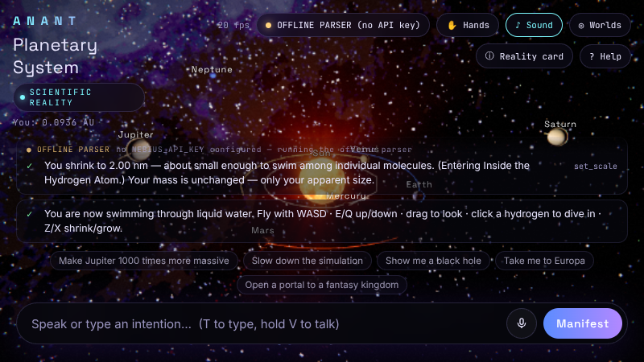
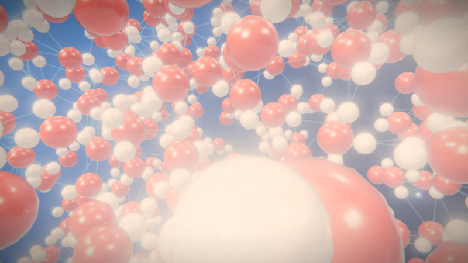
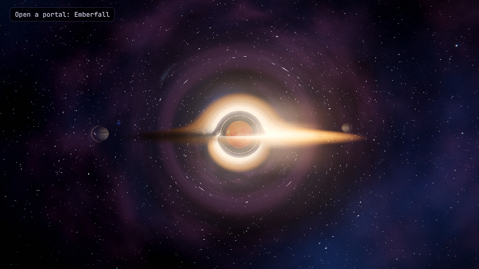
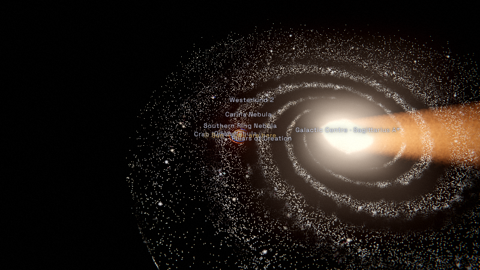
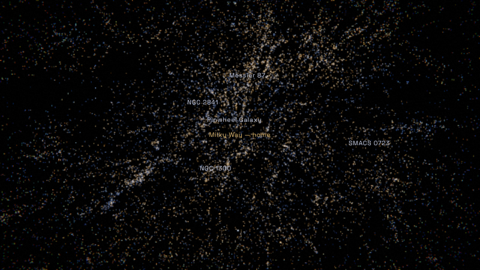
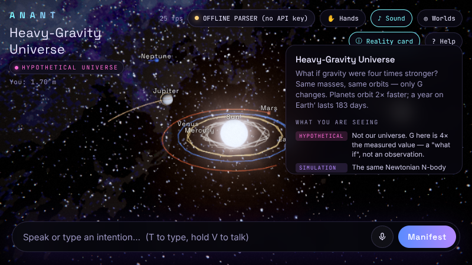

# ANANT — EXPERIENCE THE IMPOSSIBLE.

ANANT is an AI-directed immersive experience engine that runs in the browser. You speak or type an intention and an NVIDIA Nemotron model on **Nebius Token Factory** turns it into **validated, structured commands**. A deterministic engine then executes those commands. The model never runs code.

Built for the Nebius × NVIDIA hackathon.

| | |
|---|---|
|  |  |
|  |  |
|  |  |

## What you can do

| Say… | What happens |
|---|---|
| “Take me inside an atom” · “Excite the electron to 3d” | Hydrogen |ψ|² ray-marched per pixel from the Schrödinger solutions. Transitions show the real superposition, slowed by about 10¹⁵ and labelled as slowed. |
| “Make me the size of a water molecule” | You shrink into an endless periodic box of about 2,500 water molecules. They move under Langevin thermal dynamics, and hydrogen bonds are detected live. You can fly freely and click an atom to dive into it. |
| “Show me the entire solar system” · “Make Jupiter 1000× more massive” | A live N-body simulation (velocity Verlet, AU / yr / M☉) using real planetary masses and orbit sizes. |
| “Make me large enough to hold the Sun” → “switch to sandbox mode” → “let me grab the Sun” → “undo” | Your apparent size is separate from your mass. In sandbox mode you carry the Sun with the pointer or your hand, and its planets come with it. Undo, redo and reset work on every manipulation. |
| “Show me thousands of galaxies” · “Take me to Andromeda” · “Show me galaxies observed by James Webb” | 43,498 real galaxies from the 2MASS Redshift Survey and a 24-object catalogue with SIMBAD coordinates and ESA/Hubble and ESA/Webb imagery. |
| “Show me a black hole” | Schwarzschild null geodesics integrated per pixel, lensing the real Milky Way panorama. |
| “Explore Earth” or **Explore Earth** in the top bar | Fly from orbit into streamed satellite/aerial imagery over measured elevation. Search 34,188 cities or enter latitude, longitude; visit the Himalayas, Grand Canyon, New York, Mumbai and the Alps. |
| “Open a portal to a universe with stronger gravity” | A **hypothetical** universe where G is 4× ours. The same solar system is recomputed under that law, and every card labels it HYPOTHETICAL. |
| “Open a portal to a fantasy kingdom” → talk to the villagers | Emberfall, a living story village. Its NPCs remember you, and its mystery can be solved. |

Hand gestures (MediaPipe, optional) control grab, pinch-scale, rotate and drawing a circle to open a portal. Mouse and keyboard work everywhere:
- **WASD** moves.
- **C** toggles fly mode.
- **Z** / **X** shrink and grow you.
- **Shift+drag** grabs a body.
- **P** opens Cinema mode, hiding the interface and labels; **Esc** restores them.

Choose **Cinematic**, **Balanced**, or **Performance** in the top bar. Cinematic is the default: AgX tone mapping, restrained bloom, contact shading, detailed shadows and higher-quality orbital/black-hole rendering. Balanced reduces rendering cost; Performance uses simpler foliage and effects. All three run the same physics. Changing quality saves the world before reloading. URL overrides are `?quality=cinematic`, `?quality=balanced` and `?quality=performance`; the older `?lowfx` still selects Performance.

## Detailed Earth and scene assets

**Earth** opens a dedicated Cesium geospatial view. Drag to pan, scroll to zoom,
Ctrl+drag to tilt, and use **Orbit** for a slow camera move. **Cinema** hides the
controls while keeping data credits visible. **Esc** returns to the same ANANT
world; its renderer and input are suspended during Earth exploration.

The default uses public data without API keys: EOX Sentinel-2 cloudless 2016
(approximately 10 m globally), USGS/USDA aerial imagery (approximately 1 m where
available in the continental US), and Mapzen elevation. Detail and acquisition
dates vary. These are photographs over terrain, **not reconstructed 3D cities**.
A packaged orbital texture stays visible if tile services are slow. Internet is
required for streamed detail. City search uses a bundled GeoNames index and
does not send typed searches to an external geocoder.

EOX imagery passes through a fixed-source server route with tile-coordinate
validation, a 16 MB memory cache, request limits and timeouts. Elevation and USGS
imagery stream directly to the browser. The Cesium viewer is loaded only when
Earth is opened; its workers are copied by `postinstall`, `dev`, and `build`.

For actual **Google Photorealistic 3D Tiles**, optionally set
`GOOGLE_MAPS_BROWSER_KEY` in `.env` after enabling Map Tiles API in your own Google
Maps project. Restrict that key to your site's HTTP referrers and the Map Tiles
API; it is intentionally browser-visible. Leave it empty for public data. Google
mode offers bookmarks and coordinates, disables the non-Google city index, and
preserves Google's credits. Google mode requires provider access and has not
been live-verified without a configured key.

Emberfall now uses textured, rigged MakeHuman characters with idle and walking
animations, recessed windows, timber shutters, layered roof tiles and retained
foliage detail. Far trees use projections of the scanned assets to limit geometry
cost. The Nexus adds bevelled stone paving, metal housings and HDR environment
lighting. Cinema mode hides scientific orbit guides in the solar system.
These remain real-time rendered scenes, with quality limited by the assets and
the device; they are not indistinguishable from live footage.

Asset notices: [Earth data](public/assets/earth/CREDITS.md),
[characters](public/assets/characters/LICENSE.txt),
[Poly Haven and planetary maps](public/assets/CREDITS.json).
Character rebuild instructions: [character assets](docs/character-assets.md).
To verify live Earth providers after building: `node scripts/e2e-earth.mjs`.

## Honesty labels

Every realm has a Reality card that tags each statement with one of these labels:

| Tag | Meaning |
|---|---|
| **MEASURED** | Observed data, such as 2MRS positions, SIMBAD coordinates and telescope images. |
| **SIMULATION** | Computed live from physical laws, such as N-body gravity, orbitals, geodesics and water dynamics. |
| **MODEL** | A stated simplification, such as circular starting orbits, Hubble-law distances and stellar homology. |
| **ARTISTIC** | A visual choice, such as compressed distances, enlarged planets and colours. |
| **FICTION** | Emberfall and its people. |
| **HYPOTHETICAL** | A universe that is not ours. The physics is computed, but the premise is not observed. |

When the AI cannot do something, it says so and does not pretend.

## Running it

Use **Node.js 22.13 or newer** (the server uses built-in SQLite). These commands work in PowerShell and on macOS/Linux:

```bash
npm ci                 # also copies the MediaPipe wasm and downloads the hand model
npm run dev            # API on :8787, Vite on :5173
# or
npm run build
npm start              # production server on :8787
```

Optionally copy `.env.example` to `.env` and add `NEBIUS_API_KEY`. The offline parser works without an API key.

| Variable | Purpose |
|---|---|
| `NEBIUS_API_KEY` | Enables Nemotron on Nebius Token Factory. Without it, ANANT uses a deterministic offline parser and the UI labels it **OFFLINE PARSER**. |
| `NEBIUS_BASE_URL` | Defaults to `https://api.tokenfactory.nebius.com/v1`. |
| `ANANT_MODEL` | Pins a model. Otherwise the first available of `nvidia/Llama-3_3-Nemotron-Super-49B-v1_5`, `nvidia/NVIDIA-Nemotron-Nano-9B-v2`, and so on is used. |
| `ANANT_DB` | SQLite file for saved worlds (default `data/anant.db`). |

Other scripts:
- `npm test` runs the unit tests (Vitest).
- `npm run typecheck` runs the TypeScript compiler.
- Run `npx playwright install chromium` once, then `npm run e2e` to build and drive every demo scene in headless Chromium. It writes `test-results/e2e.json` plus screenshots, uses a separate temporary database, forces the offline parser, and shuts down its own server. The default test quality is Performance; set `E2E_QUALITY=cinematic` for visual review, or `E2E_SOFTWARE=1` to force SwiftShader. In PowerShell, set these with `$env:E2E_QUALITY='cinematic'` before running the command. The report records the actual GPU/backend.
- `node scripts/fetch-assets.mjs` and `node scripts/build-astro.mjs` re-download and rebuild the art and astronomy data, which are already committed under `public/assets`.

## Architecture

```
voice / text / gesture
        │
        ▼
 server/director.ts ── Nemotron (Nebius) ──► JSON reply ──┐
        │   (no key / failure → shared/localParser.ts)    │
        ▼                                                 ▼
 shared/commands.ts  — Zod schemas + semantic checks (max 12 commands, no code)
        ▼
 shared/worldState.ts — deterministic reducer execute(state, cmd) → state + result
        ▼
 src/App.ts — side effects (travel, camera, undo stack), persistence via server/db.ts (node:sqlite)
        ▼
 src/engine/* — Three.js r169 renderer: HDR + MSAA composer, god rays, bloom, grading,
                portals that render live views of other realms, adaptive resolution
 src/realms/* — Nexus · Atom (+ water field, scale layers) · Cosmos (+ Milky Way, galaxy
                field, black hole) · Village (Emberfall) · HeavyUniverse (hypothetical)
```

- **Universes.** `shared/universes.ts` defines universes as a set of constants plus a status (`observed` or `hypothetical`). `HeavyUniverse` reuses the Cosmos machinery and supplies its own G, bodies and labels. Adding a universe means adding one definition and one realm class.
- **Scale.** `shared/scale.ts` maps the observer's apparent size (from 10⁻¹⁵ m to 10²⁶ m) to a realm and a view, so “make me smaller” works the same way everywhere.

## Verification

- 123 unit tests cover:
  - command validation and the reducer;
  - physics (energy conservation, orbital elements, invertible display compression);
  - hydrogen normalisation;
  - the parser, director repair, story, gestures and persistence;
  - scale, the astronomy catalogue, manipulation with undo, and the multiverse.
  - saved-world isolation, pending gesture undo, unpause/unfreeze, and moving-subject camera tracking.
  - Earth tile boundaries, coordinate input and terrain height decoding.
- `npm run e2e` walks the full demo, including the directive scenes, in Chromium:
  - microscopic water, the galaxy field and Andromeda;
  - holding, moving and undoing the Sun;
  - the multiverse portal;
  - a page reload that checks persistence.
  - switching saved worlds, reloading the selected world, and Cinema keyboard controls.
- GitHub Actions runs type checking, unit tests and production builds on Windows and Ubuntu with Node 22.

## Known limitations

- **No live Nemotron run is recorded here.** The development container had no `NEBIUS_API_KEY`, so every verification ran on the offline parser. The Nebius endpoint was reachable. The Nemotron path (JSON extraction, one repair attempt, schema validation) is covered by unit tests with a mocked API.
- **Rendering cost varies by scene and GPU.** The cinematic revision was exercised in headless Chromium on Intel integrated graphics through Direct3D 11. The detailed village and galaxy scenes can run below 30 fps on that hardware; use Balanced or Performance when responsiveness matters more than visual detail. Cinematic keeps at least native pixel density. These measurements are not an RTX benchmark.
- **Visual exaggeration.**
  - Characters use textured MakeHuman meshes and animation; buildings remain procedural geometry. These are rendered game assets, not scanned people or film-production assets.
  - Solar-system distances are compressed (∝√r) and planets are drawn far too large.
  - Galaxy-field distances come from redshift (H₀ = 70), so peculiar velocities smear clusters.
  - Named galaxies are image impostors, not 3D models.
- **The hypothetical universe can only be observed** in this build. Its bodies cannot be edited; gravity and time can still be changed.
- The water field is a classical, coarse-grained model, not ab-initio molecular dynamics.

## Credits

- **Poly Haven** (CC0): models, PBR textures and HDRIs used in Emberfall and the Nexus. Per-asset authors are listed in `public/assets/CREDITS.json`.
- **Solar System Scope** (CC BY 4.0): planet, Sun and Milky Way maps, based on NASA and ESO imagery.
- **ESA/Hubble and ESA/Webb** (CC BY 4.0): galaxy and nebula images. Each image's credit line is shown in the app and stored in `public/assets/astro/catalog.json`.
- **2MASS Redshift Survey**, Huchra et al. 2012, ApJS 199, 26 (via VizieR J/ApJS/199/26).
- **SIMBAD** astronomical database, CDS Strasbourg.
- **MediaPipe Hand Landmarker** (Apache-2.0), Google.
- **MakeHuman** (CC0 core assets) and CMU motion capture: character source notes are in `docs/character-assets.md` and `public/assets/characters/LICENSE.txt`.
- **EOX Sentinel-2 cloudless 2016**, **USGS / USDA NAIP**, **Mapzen terrain** and **GeoNames**: Earth source and licence notices are in `public/assets/earth/CREDITS.md`; provider attribution remains visible in the viewer.
- Rendering uses Three.js (MIT) and CesiumJS (Apache-2.0); validation uses Zod (MIT).

## License

The code is licensed under Apache-2.0 (see `LICENSE`). Third-party assets keep their own licences, as listed above.
